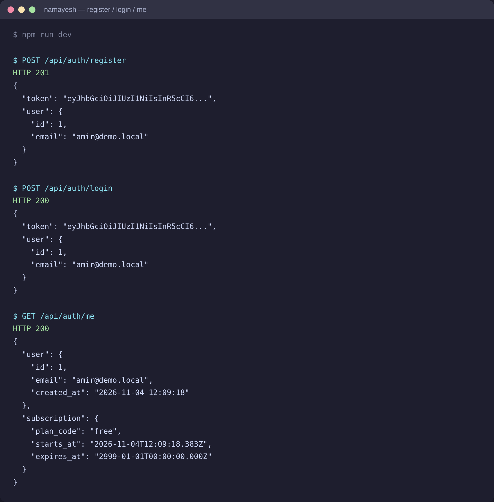
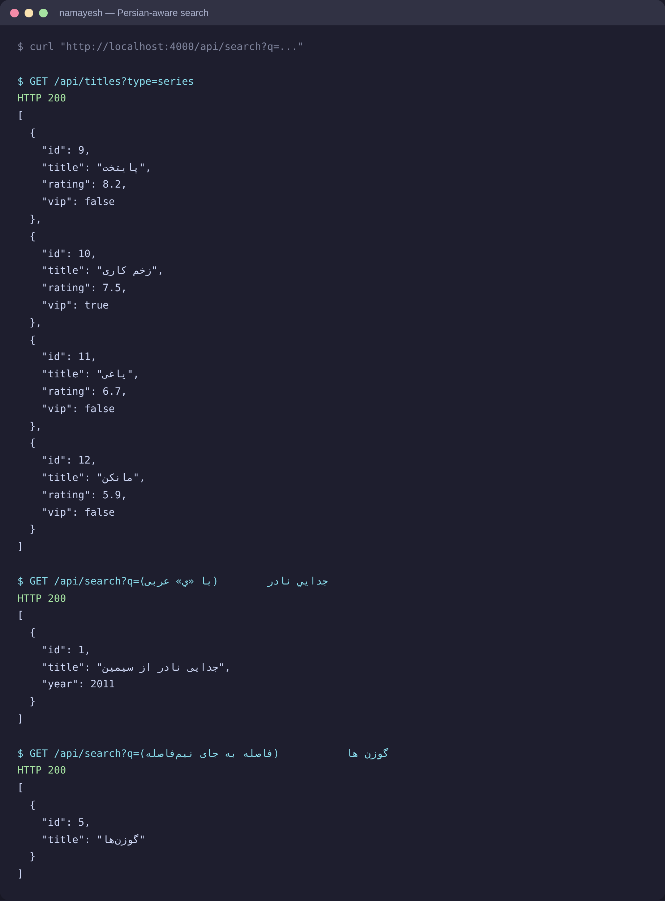
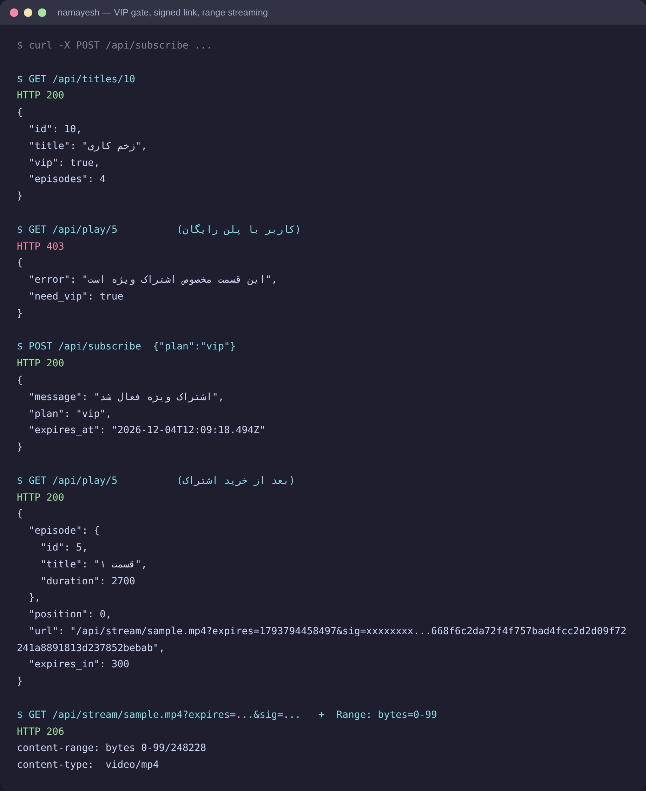
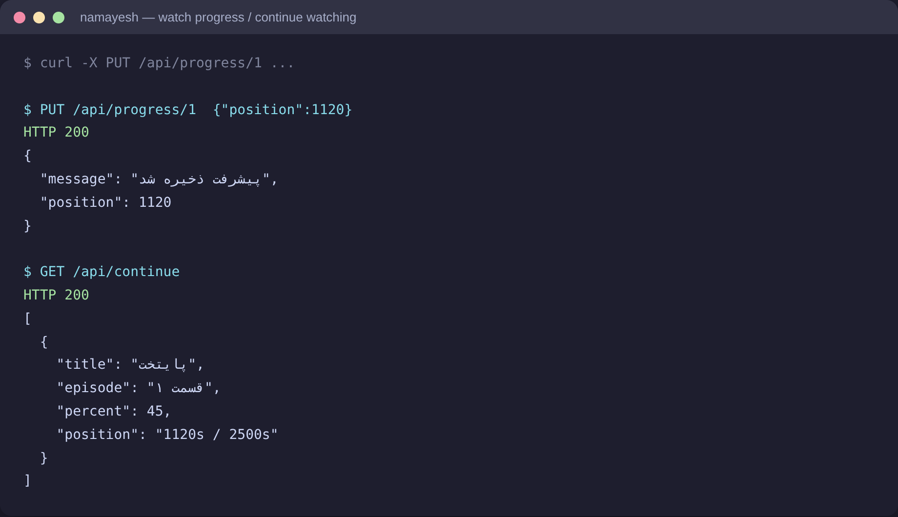
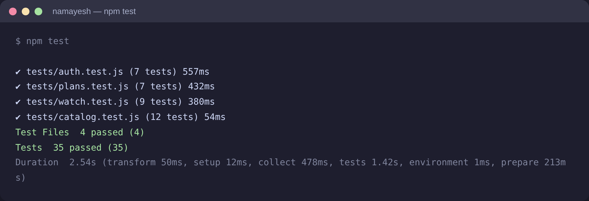

# namayesh

A mini movie & series streaming platform API — plain Node.js + Express + SQLite. No TypeScript, no Docker, no ORM, no external database to install.

Not another todo app: it has real subscription gating, watch progress with resume, signed expiring video links and Persian-aware search.

## Features

- JWT auth (register / login, bcrypt passwords)
- Plans: `free` / `vip` — every new user starts on the free plan
- VIP-only episodes → `403 need_vip` until the user subscribes
- Watch progress per episode + a "continue watching" list with percentages (finished episodes are hidden automatically)
- Signed expiring stream links (HMAC-SHA256, 5 minutes) with HTTP Range support — real streaming with `206 Partial Content`
- Persian-aware search: typing «جدايي» with Arabic ي still finds «جدایی نادر از سیمین», and half-space vs space differences are normalized away
- "Similar titles" by genre
- SQLite with WAL — the database file is created and seeded automatically on first run

## Quick start

Node 20+ required.

```bash
git clone https://github.com/AmirRedox2008/namayesh.git
cd namayesh
npm install
npm run dev
```

The API is now on `http://localhost:4000`. On first run it creates `data/namayesh.db` and seeds it with a small catalog of Iranian movies and series (8 movies, 4 series, 16 episodes).

Optional config: `cp .env.example .env`

## Try it

```bash
curl -X POST http://localhost:4000/api/auth/register \
  -H "Content-Type: application/json" \
  -d '{"email":"me@test.com","password":"secret123"}'

curl http://localhost:4000/api/search?q=%D8%AC%D8%AF%D8%A7%D9%8A%D9%8A
```

The whole VIP flow: a free user gets `403 need_vip` on a VIP episode, subscribes, and the same episode opens with a signed play link.

## API

| Method | Path | Auth | Description |
| --- | --- | --- | --- |
| POST | `/api/auth/register` | — | Create an account (starts on the free plan) |
| POST | `/api/auth/login` | — | Get a JWT |
| GET | `/api/auth/me` | ✔ | Profile + current subscription |
| GET | `/api/titles` | — | Catalog, filterable with `?type=movie\|series` and `?genre=کمدی` |
| GET | `/api/titles/:id` | — | Details (+ episodes for series) |
| GET | `/api/titles/:id/similar` | — | Same-genre titles |
| GET | `/api/search?q=` | — | Persian-aware search |
| GET | `/api/genres` | — | All genres |
| GET | `/api/plans` | — | Plans and prices |
| POST | `/api/subscribe` | ✔ | Buy VIP for 30 days (extends if already VIP) |
| GET | `/api/play/:episodeId` | ✔ | Play link — checks VIP, returns the resume position |
| GET | `/api/stream/:file` | — | Serves the video, only for valid signed URLs |
| PUT | `/api/progress/:episodeId` | ✔ | Save the watch position in seconds |
| GET | `/api/continue` | ✔ | Continue watching |

## How the signed links work

`GET /api/play/:id` returns a link that is valid for 5 minutes:

```
/api/stream/sample.mp4?expires=1793794458497&sig=9f1c...
```

`sig` is `HMAC_SHA256(VIDEO_SECRET, file + expires)`. The stream route recomputes it and rejects expired or tampered links with `403`. A payment gateway is intentionally left out — subscribing is instant so the gating can be tested end to end.

## Tests

35 tests with vitest + supertest, no mocking — they run against a real SQLite database that is rebuilt for every run:

```bash
npm test
```

## Screenshots











## Project structure

```
src/
  index.js      entry point, listens on PORT
  app.js        express app, mounts the routers
  db.js         sqlite connection + schema + auto-seed
  seed.js       demo catalog: 8 movies, 4 series with episodes
  auth.js       register / login / me + auth middleware
  catalog.js    titles, search, genres, similar
  plans.js      plans + subscribe
  watch.js      play, stream, progress, continue watching
  normalize.js  Persian text normalization for search
```

## License

MIT
